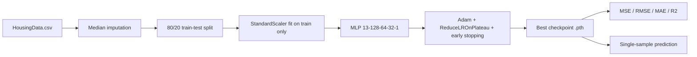

# MLP Boston Housing Price Prediction

[English](README.md) | [简体中文](README.zh-CN.md)

A PyTorch implementation of a fully connected feedforward network for predicting median owner-occupied home values in the Boston area, served as a compact reference for regression with tabular data.

## Project Introduction

The Boston Housing dataset is a small, well-known regression benchmark: 506 records, 13 numeric features, and one continuous target. It is small enough to train on a CPU in seconds, and messy enough (120 missing values, a capped target) to make preprocessing decisions matter. This project walks through the whole path in a single notebook: cleaning, exploration, model construction, training with regularization and early stopping, evaluation, and a single-sample inference demo.

The goal is not to squeeze out the last decimal of R². It is to keep every step readable and reproducible, so the notebook can be read top to bottom as a working example of how a plain MLP should be wired for tabular regression.



### Dataset

The dataset comes from [Kaggle](https://www.kaggle.com/datasets/altavish/boston-housing-dataset) and is bundled in the repository as `HousingData.csv`.

| Feature | Description |
| --- | --- |
| CRIM | Per-capita crime rate by town |
| ZN | Proportion of residential land zoned for lots over 25,000 sq. ft. |
| INDUS | Proportion of non-retail business acres per town |
| CHAS | Charles River dummy variable (1 if the tract bounds the river, else 0) |
| NOX | Nitric oxide concentration (parts per 10 million) |
| RM | Average number of rooms per dwelling |
| AGE | Proportion of owner-occupied units built before 1940 |
| DIS | Weighted distance to five Boston employment centers |
| RAD | Index of accessibility to radial highways |
| TAX | Full-value property tax rate per $10,000 |
| PTRATIO | Pupil-teacher ratio by town |
| B | 1000(Bk - 0.63)², where Bk is the proportion of Black residents |
| LSTAT | Percentage of the population with lower social status |
| MEDV | Median value of owner-occupied homes in thousand dollars (target) |

Two dataset quirks drive the preprocessing code:

- **120 missing values** are spread across several columns. They are filled with the column median, which is robust to the skewed distributions of CRIM and B.
- **MEDV is capped at 50** by the original census methodology, so the model can never learn above that ceiling. Expect underpredictions in the expensive tail.

### Model

```
Input (13) → Linear 128 → BatchNorm → ReLU → Dropout(0.2)
           → Linear  64 → BatchNorm → ReLU → Dropout(0.2)
           → Linear  32 → BatchNorm → ReLU → Dropout(0.2)
           → Linear   1
```

The output layer has no activation, since this is a regression task. Batch normalization keeps the loss surface well conditioned on standardized inputs, and dropout at 0.2 adds enough noise to slow down the fast overfitting that small tabular datasets tend to produce. Total parameters: 12,609.

### Training setup

| Parameter | Value | Note |
| --- | --- | --- |
| Loss | MSELoss | Standard for regression |
| Optimizer | Adam, lr = 1e-3 | weight_decay = 1e-5 |
| LR scheduler | ReduceLROnPlateau | factor 0.5, patience 10 |
| Batch size | 256 | Small dataset, few steps per epoch |
| Max epochs | 300 | Usually stopped far earlier |
| Early stopping | patience 30 | Monitors validation loss |
| Test size | 0.2 | 102 samples, seed 42 |

The checkpoint is saved every time validation loss reaches a new minimum, so the file in the repository always corresponds to the best epoch, not the last one.

### Results

Metrics on the 102-sample test split:

| Metric | Value |
| --- | --- |
| MSE | 12.08 |
| RMSE | 3.48 (thousand dollars) |
| MAE | 2.02 (thousand dollars) |
| R² | 0.835 |

An average absolute error of roughly two thousand dollars on a target ranging from 5 to 50 is reasonable for a plain MLP with no feature engineering. The residual plots show the expected pattern: errors widen at the high end because of the MEDV ceiling.

## Dependencies


| Package | Purpose |
| --- | --- |
| `torch` | Model definition, training loop, checkpointing |
| `numpy` | Array operations and metric computation |
| `pandas` | CSV loading, missing value handling |
| `scikit-learn` | Train/test split, feature standardization |
| `matplotlib` | Feature distributions, heatmap, residual plots |
| `jupyter` | Notebook runtime |

```bash
pip install torch numpy pandas scikit-learn matplotlib jupyter
```

The plotting cells set `font.family = 'SimHei'` for Chinese labels, which assumes a Windows environment with that font installed. On macOS or Linux, change the font or remove the line.

## Project Structure

```
MLP-boston_housing_prediction/
├── house_price_prediction.ipynb   # Full workflow: data, model, training, evaluation
├── HousingData.csv                # Boston Housing dataset (506 x 14)
├── house_price_model.pth          # Best checkpoint from the last training run
├── LICENSE                        # MIT
├── README.md                      # English documentation
└── README.zh-CN.md                # Chinese documentation
```

## Usage

Clone the repository and start Jupyter:

```bash
git clone https://github.com/anjuxi/MLP-boston_housing_prediction.git
cd MLP-boston_housing_prediction
jupyter notebook house_price_prediction.ipynb
```

Run the cells in order. The notebook is linear and keeps no hidden state between sections, so restarting the kernel and running all cells reproduces the reported metrics.

**Continue training.** `CONTINUE_TRAIN` in the constants cell is set to `1` by default, which loads `house_price_model.pth` before training. Set it to `0` when you want a clean run from random initialization.

**Single prediction.** The last cell calls `predict_single` with 13 raw feature values. Standardization is applied inside the function using the mean and scale saved during preprocessing, so no manual scaling is needed:

```python
price = predict_single(model, 0.00632, 18.0, 2.31, 0, 0.538, 6.575,
                       65.2, 4.09, 1, 296, 15.3, 396.9, 4.98)
print(f"Predicted median value: {price:.2f} thousand dollars")
```

The three bundled examples return roughly 24.56, 23.01, and 16.27 thousand dollars, ordered from the most expensive neighborhood to the cheapest.

## Contributing

Issues and pull requests are welcome:

1. Fork the repository and create a branch named after the change, e.g. `feature/min-max-scaler`.
2. Keep changes scoped. If you touch preprocessing, note whether existing checkpoints remain valid, since the scaler parameters are tied to the training split.
3. Describe the motivation and the observed effect in the pull request. For metric changes, include the numbers before and after.
4. Report bugs with the Cell index, the error message, and the environment (Python and PyTorch versions).

## Contact

**Dr. Ailan Anjuxi (谙弆悕)**

- 📫 Email: anjuxi.ME@outlook.com
- 📞 SIP: sip:anjuxi@sip.linphone.org

Licensed under the MIT License. See [LICENSE](LICENSE) for details.
