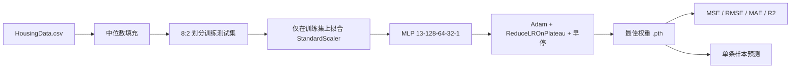

# 全连接网络-波士顿房价预测

[English](README.md) | [简体中文](README.zh-CN.md)

用 PyTorch 搭建一个多层全连接网络，预测波士顿地区自住房屋价值的中位数。项目保持单 notebook 的线性结构，可以作为表格数据回归任务的最小可用示例。

## 项目介绍

波士顿房价是一个小而经典的回归基准：506 条记录、13 个数值特征、1 个连续目标。数据量小到 CPU 几秒就能训完，同时又脏到足够让预处理成为关键决策——120 个缺失值，目标还被截断在 50 千美元。本项目把一个完整的流程走通：清洗、探索、建模、带正则和早停的训练、评估、单条样本推理。

目标不是把 R² 再挤出小数点后几位，而是让每一步都能被读懂、能被复现。从头到尾按顺序读 notebook，就能看清一个朴素 MLP 在表格回归任务上应该怎么接。



### 数据集

数据来自 [Kaggle](https://www.kaggle.com/datasets/altavish/boston-housing-dataset)，已随仓库提供为 `HousingData.csv`。

| 特征 | 说明 |
| --- | --- |
| CRIM | 城镇人均犯罪率 |
| ZN | 住宅用地超过 25000 平方英尺的比例 |
| INDUS | 城镇非零售业务用地比例 |
| CHAS | 查尔斯河虚拟变量，临河为 1，否则为 0 |
| NOX | 一氧化氮浓度（千万分之一） |
| RM | 每栋住宅的平均房间数 |
| AGE | 1940 年之前建成的自住房屋比例 |
| DIS | 到波士顿五个就业中心的加权距离 |
| RAD | 径向公路可达性指数 |
| TAX | 每万美元全值财产税率 |
| PTRATIO | 城镇师生比 |
| B | 1000(Bk - 0.63)²，Bk 为黑人居民比例 |
| LSTAT | 低收入人群占比 |
| MEDV | 自住房屋价值中位数，单位千美元（目标） |

数据里有两处需要特别处理：

- **120 个缺失值**分散在多列。统一用列中位数填充，原因是 CRIM 和 B 的分布偏得厉害，均值会被长尾拉走。
- **MEDV 在 50 千美元处被截断**，这是当年普查方式的产物，模型在理论上也学不到更高的值。因此高价区间的预测会系统性偏低，属于数据本身的限制，不是训练问题。

### 模型结构

```
输入 (13) → Linear 128 → BatchNorm → ReLU → Dropout(0.2)
          → Linear  64 → BatchNorm → ReLU → Dropout(0.2)
          → Linear  32 → BatchNorm → ReLU → Dropout(0.2)
          → Linear   1
```

回归任务，输出层不加激活函数。批归一化让标准化之后的数据有更稳定的损失曲面，0.2 的 dropout 则用来压住小数据集上很快就出现的过拟合。总参数量 12,609。

### 训练配置

| 参数 | 取值 | 说明 |
| --- | --- | --- |
| 损失函数 | MSELoss | 回归任务的标准选择 |
| 优化器 | Adam，lr = 1e-3 | weight_decay = 1e-5 |
| 学习率调度 | ReduceLROnPlateau | factor 0.5，patience 10 |
| 批大小 | 256 | 数据少，每轮步数很少 |
| 最大轮数 | 300 | 实际远未跑满就停了 |
| 早停 | patience 30 | 监控验证损失 |
| 测试集比例 | 0.2 | 102 条样本，随机种子 42 |

验证损失每创新低就保存一次权重，所以仓库里的 `.pth` 对应的是最佳轮次，不是最后一轮。这个细节在评估时很重要：训练结束后会重新加载最佳权重再做测试。

### 实验结果

在 102 条测试样本上的表现：

| 指标 | 数值 |
| --- | --- |
| MSE | 12.08 |
| RMSE | 3.48（千美元） |
| MAE | 2.02（千美元） |
| R² | 0.835 |

目标值跨度在 5 到 50 千美元之间，平均绝对误差约两千美元，对没有任何特征工程的朴素 MLP 来说是合理水平。残差图会呈现预期的形态：误差随预测值升高而扩大，根源还是 MEDV 的封顶截断。

## 依赖说明


| 依赖包 | 用途 |
| --- | --- |
| `torch` | 模型定义、训练循环、权重保存 |
| `numpy` | 数组运算与指标计算 |
| `pandas` | CSV 读取、缺失值处理 |
| `scikit-learn` | 训练测试集划分、特征标准化 |
| `matplotlib` | 特征分布、相关性热力图、残差图 |
| `jupyter` | Notebook 运行环境 |

```bash
pip install torch numpy pandas scikit-learn matplotlib jupyter
```

绘图单元格里设置了 `font.family = 'SimHei'` 以支持中文标签，这默认是 Windows 环境且已安装该字体。在 macOS 或 Linux 上请改成系统自带的中文字体，或者直接删掉这一行。

## 项目结构

```
MLP-boston_housing_prediction/
├── house_price_prediction.ipynb   # 完整流程：数据、建模、训练、评估
├── HousingData.csv                # 波士顿房价数据集（506 x 14）
├── house_price_model.pth          # 上一次训练得到的最佳权重
├── LICENSE                        # MIT 协议
├── README.md                      # 英文文档（主文档）
└── README.zh-CN.md                # 中文文档
```

## 使用说明

克隆仓库并启动 Jupyter：

```bash
git clone https://github.com/anjuxi/MLP-boston_housing_prediction.git
cd MLP-boston_housing_prediction
jupyter notebook house_price_prediction.ipynb
```

按顺序执行单元格即可。notebook 是线性的，各段之间不保留隐藏状态，重启内核后从头运行就能复现上面报告的指标。

**继续训练。** 常量单元格里的 `CONTINUE_TRAIN` 默认是 `1`，训练前会加载 `house_price_model.pth`。想做一次干净的、从随机初始化开始的训练，把它改成 `0`。

**单条预测。** 最后一个单元格调用 `predict_single`，传入 13 个原始特征值。标准化在函数内部完成，用的是预处理阶段保存的均值和标准差，不需要手动缩放：

```python
price = predict_single(model, 0.00632, 18.0, 2.31, 0, 0.538, 6.575,
                       65.2, 4.09, 1, 296, 15.3, 396.9, 4.98)
print(f"预测房价中位数: {price:.2f} 千美元")
```

仓库自带的三个示例分别输出约 24.56、23.01、16.27 千美元，从高价社区一路排到低价社区。

## 贡献指南

欢迎提 issue 和 PR，几点约定：

1. 先 fork 仓库，新建一个按改动命名的分支，比如 `feature/min-max-scaler`。
2. 改动保持聚焦。如果动了预处理，请在 PR 里说明旧权重是否还能用——标准化参数是和训练集划分绑定的。
3. PR 描述里写清动机和观察到的效果。涉及指标的改动，把改动前后的数值都贴出来。
4. 报 bug 请给出出错的单元格序号、报错信息，以及 Python 和 PyTorch 版本。

## 联系作者

**谙弆悕博士（Ailan Anjuxi）**

- 📫 邮箱：anjuxi.ME@outlook.com
- 📞 SIP 电话：sip:anjuxi@sip.linphone.org

本项目采用 MIT 协议，详见 [LICENSE](LICENSE)。
